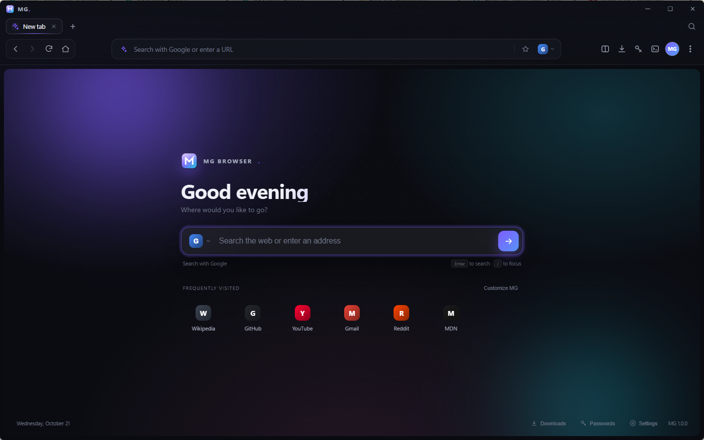
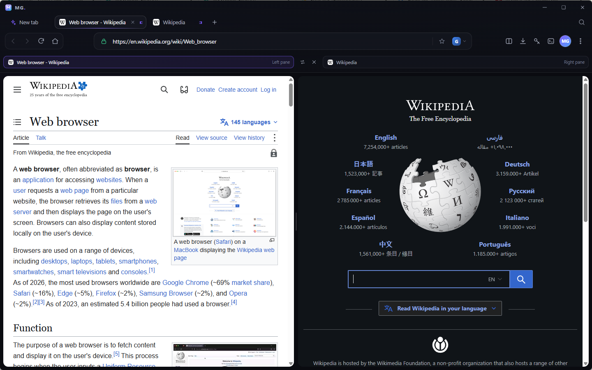
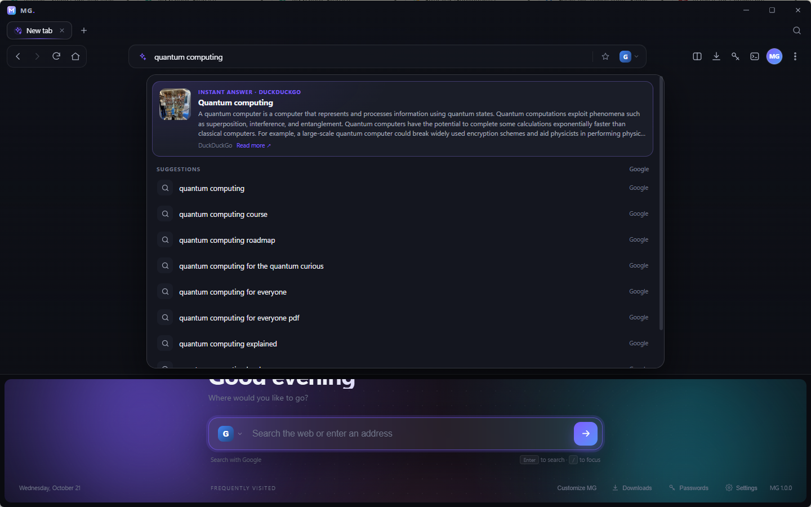
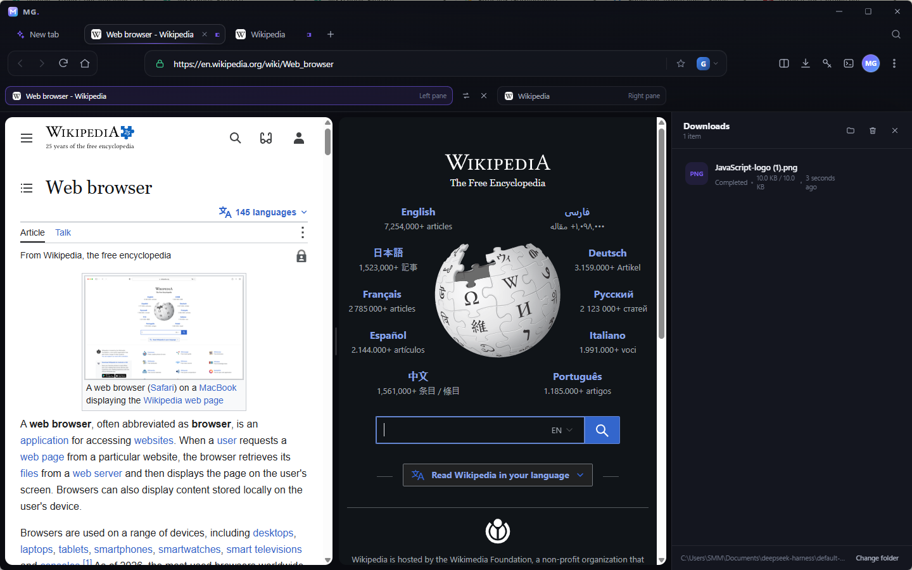
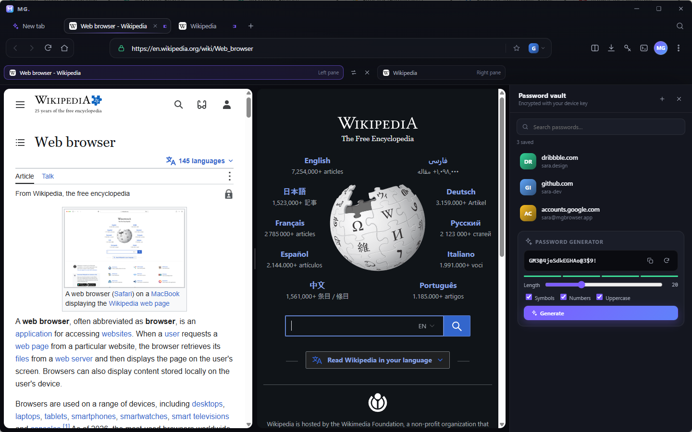
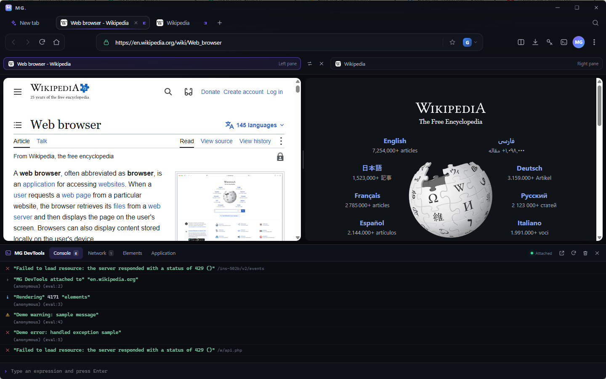
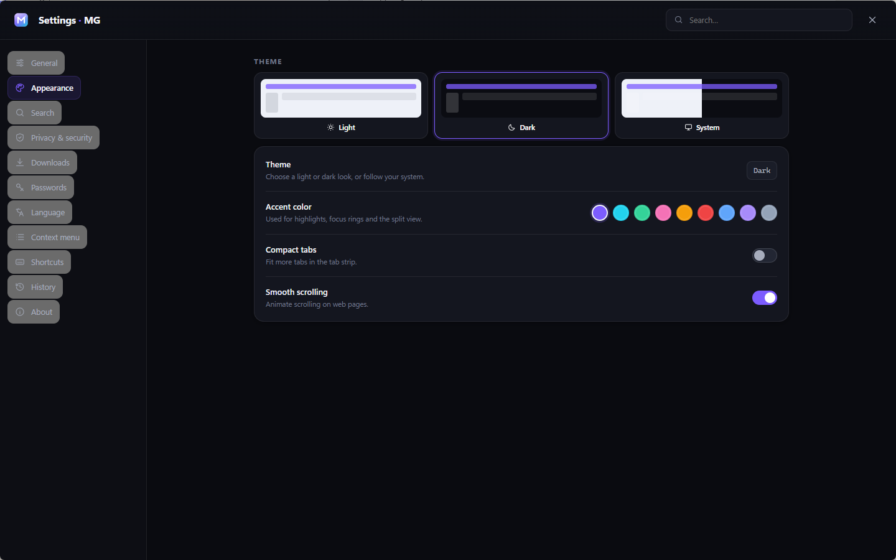
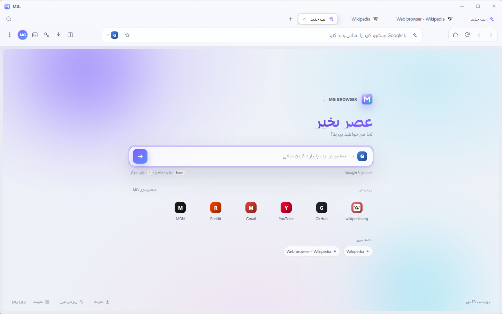
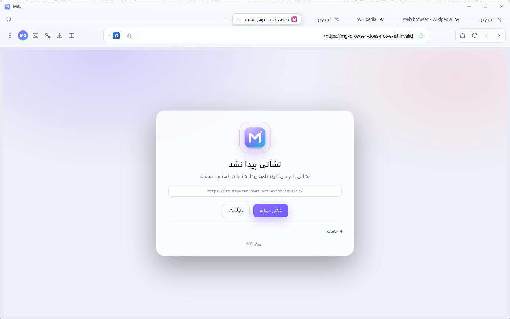
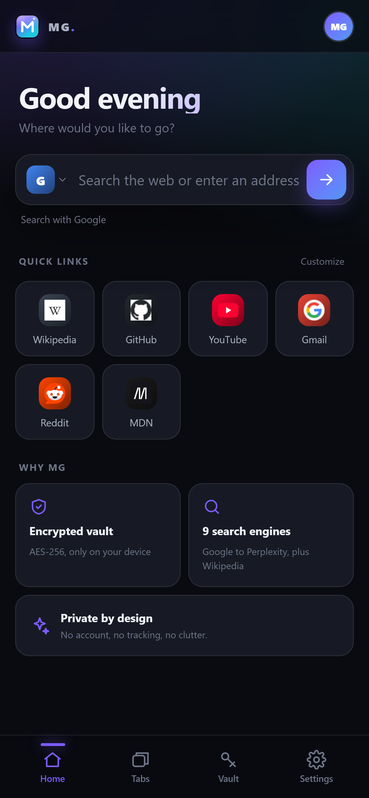

# MG Browser

**مرورگر مدرن با نمای تقسیم‌شده، جستجوی زنده، گاوصندوق رمز و DevTools سفارشی.**



---

## فهرست

- [نمای کلی](#نمای-کلی)
- [سیاست امضای کد](#code-signing-policy)
- [نسخه‌ها](#نسخهها)
- [شروع سریع (ویندوز)](#شروع-سریع-ویندوز)
- [ویژگی‌ها](#ویژگیها)
- [ساخت از سورس](#ساخت-از-سورس)
- [معماری](#معماری)
- [داده‌ها و امنیت](#دادهها-و-امنیت)
- [شخصی‌سازی](#شخصیسازی)
- [نسخه موبایل](#نسخه-موبایل)
- [محدودیت‌ها](#محدودیتها)
- [English](#english)

---

## نمای کلی

MG Browser یک مرورگر واقعی مبتنی بر Electron و Chromium است: هر تب یک `WebContentsView` واقعی با نشست پایدار، کوکی و ورود به حساب گوگل است. رابط کاربری کاملاً اختصاصی طراحی شده — نه یک پوسته آماده.

## Code signing policy

Free code signing provided by [SignPath.io](https://about.signpath.io), certificate by [SignPath Foundation](https://signpath.org).

- Authors / committers: [@YOUR_GITHUB_USERNAME](https://github.com/YOUR_GITHUB_USERNAME)
- Reviewers: [@YOUR_GITHUB_USERNAME](https://github.com/YOUR_GITHUB_USERNAME) — all pull requests are reviewed before merge
- Approvers: [@YOUR_GITHUB_USERNAME](https://github.com/YOUR_GITHUB_USERNAME) — approves every release before signing

Privacy policy: [docs/PRIVACY.md](docs/PRIVACY.md). MG Browser does not transfer any information to other networked systems unless specifically requested by the user (search, page navigation, downloads) or by the person installing or operating it.

> وضعیت: درخواست SignPath Foundation در حال بررسی است. تا تأیید نشدن، ریلیزها بدون امضا منتشر می‌شوند. جزئیات و برنامه ساخت شهرت: [docs/SIGNPATH.md](docs/SIGNPATH.md).

| نمای تقسیم‌شده | جستجوی زنده |
| --- | --- |
|  |  |

| دانلودها | گاوصندوق رمز |
| --- | --- |
|  |  |

| MG DevTools | تنظیمات |
| --- | --- |
|  |  |

| فارسی + روشن | صفحه خطا |
| --- | --- |
|  |  |

---

## نسخه‌ها

| پلتفرم | وضعیت | مسیر / روش |
| --- | --- | --- |
| **Windows 10/11 (x64)** | ✅ بیلد آماده و تست‌شده | `release/MG-Browser-win-x64/MG-Browser.exe` |
| **macOS (Intel / Apple Silicon)** | ⚙️ سورس + کانفیگ آماده | `npm run dist:mac` روی مک (یا GitHub Actions) |
| **Linux (AppImage / deb)** | ⚙️ سورس + کانفیگ آماده | `npm run dist:linux` روی لینوکس (یا GitHub Actions) |
| **Android / iOS** | 📱 نسخه موبایل (PWA + Capacitor) | `mobile/` — صفحات در مرورگر امن دستگاه باز می‌شوند |

> بیلد مک و لینوکس باید روی همان سیستم‌عامل ساخته شود (امضای کد مک و بسته‌بندی بومی). فایل [GitHub Actions](.github/workflows/build.yml) هر سه نسخه دسکتاپ را به‌صورت خودکار می‌سازد.

---

## شروع سریع (ویندوز)

۱. پوشه `release/MG-Browser-win-x64` را باز کنید.
۲. `MG-Browser.exe` را اجرا کنید. (بدون نصب، پرتابل)
۳. برای ساخت میانبر روی دسکتاپ و منوی Start، در همان پوشه اجرا کنید:

```powershell
powershell -ExecutionPolicy Bypass -File .\Install-MG-Browser.ps1
```

حذف برنامه: `Uninstall-MG-Browser.ps1` (داده‌های شما فقط با تأیید حذف می‌شود).

**میانبرهای مهم:** `Ctrl+T` تب جدید · `Ctrl+Shift+S` نمای تقسیم‌شده · `Ctrl+L` نوار نشانی · `F12` ابزار توسعه · `Ctrl+J` دانلودها · `Ctrl+,` تنظیمات · `Alt+←/→` عقب/جلو.

### هشدار Windows SmartScreen

اگر ویندوز پیام **«Windows protected your PC»** نشان می‌دهد، به این معنی است که این فایل **امضای دیجیتال تجاری** ندارد و هنوز در SmartScreen شهرت نگرفته — نه اینکه ویروسی پیدا شده باشد. سه راه دارید:

1. **سریع‌ترین راه:** روی «More info» بزنید و سپس **Run anyway** را انتخاب کنید.
2. **حذف کامل هشدار (توصیه‌شده):** بعد از استخراج ZIP، در همان پوشه اجرا کنید:
   ```powershell
   powershell -ExecutionPolicy Bypass -File .\Unblock-MG-Browser.ps1
   ```
   یا کل پوشه را یک‌جا آزاد کنید:
   ```powershell
   Get-ChildItem . -Recurse | Unblock-File
   ```
3. **قبل از استخراج:** روی فایل ZIP راست‌کلیک → Properties → تیک **Unblock** → OK. سپس استخراج کنید.

نصب‌کننده `Install-MG-Browser.ps1` هم فایل‌ها را به‌طور خودکار Unblock می‌کند. برای توزیع عمومی بدون این هشدار، به یک **گواهی Code Signing (OV/EV)** نیاز است و باید با `signtool`/`electron-builder` فایل را امضا کنید؛ در این محیط گواهی تجاری موجود نیست. هرگز SmartScreen را به‌صورت سراسری غیرفعال نکنید.

---

## ویژگی‌ها

### تب‌ها و ناوبری
- تب‌های واقعی با نام، فاوآیکون، نشانگر بارگذاری، پین، بی‌صدا و بستن با کلیک وسط.
- جابه‌جایی تب‌ها با درگ، منوی راست‌کلیک اختصاصی تب، بازگشایی تب بسته‌شده (`Ctrl+Shift+T`).
- دکمه‌های عقب / جلو / reload / توقف / خانه در نوار ابزار.
- حفظ و بازیابی تب‌ها هنگام اجرای مجدد.
- **نمای تقسیم‌شده (Split View):** دو صفحه واقعی کنار هم، هر پنل با هدر نام و فاوآیکون، جداکننده قابل درگ و جابه‌جایی پنل‌ها.
- نوار پیشرفت مدرن، صفحه خطای اختصاصی (آفلاین / دامنه پیدا نشد / کرش) و بازیابی خودکار.

### جستجو
- **۷ موتور جستجو + ویکی‌پدیا + Perplexity:**
  Google، Bing، DuckDuckGo، Brave، Yahoo، Yandex، Startpage، Wikipedia، Perplexity.
- پیشنهادهای زنده هم‌زمان با تایپ از موتور پیش‌فرض + ویکی‌پدیا.
- **نتایج زنده زیر جستجو:** پاسخ فوری ویکی‌پدیا/DuckDuckGo، ماشین‌حساب داخلی، تاریخچه و تب‌های باز.
- نوار موتور جستجو داخل نوار نشانی و امکان جستجو با هر ۹ موتور با یک کلیک.
- افزودن موتور جستجوی سفارشی از تنظیمات (`{q}` یا `%s`).

### دانلود و رمز
- **Download Manager:** پیشرفت لحظه‌ای، توقف/ادامه/لغو، باز کردن فایل، نمایش در پوشه، مسیر قابل تغییر، تاریخچه پایدار.
- **Password Manager:** تشخیص فرم ورود، پیشنهاد ذخیره، پرکردن خودکار در سایت مطابق، تولید رمز قوی، جستجو/نمایش/کپی/حذف.
- رمزها با **safeStorage** سیستم‌عامل (Keychain/DPAPI/libsecret) رمزنگاری می‌شوند و در نبود آن با AES-256-GCM.

### حساب گوگل
- پس از ورود در هر تب گوگل (یا پاپ‌آپ ورود)، تصویر پروفایل به‌صورت خودکار در دایره کوچک نوار ابزار نمایش داده می‌شود.
- نام و ایمیل از aria-label حساب استخراج و فقط از دامنه‌های مجاز گوگل پذیرفته می‌شود.
- منوی حساب: مدیریت حساب، تغییر/حذف عکس، رمزها، تنظیمات.

### ظاهر، زبان و شخصی‌سازی
- تم **تیره / روشن / سیستم**، ۹ رنگ تأکیدی، طراحی شیشه‌ای با گوشه‌های نرم و انیمیشن‌های ظریف.
- **فارسی و انگلیسی**، پیش‌فرض انگلیسی، چیدمان کامل RTL در فارسی، فونت **وزیرمتن** و تنظیم line-height برای جلوگیری از بریده‌شدن حروف فارسی در همه پلتفرم‌ها.
- **منوی راست‌کلیک سفارشی** با ظاهر اختصاصی MG (نه منوی پیش‌فرض سیستم)، کاملاً فارسی/انگلیسی و قابل شخصی‌سازی؛ ۲۲ گزینه + اکشن‌های سفارشی با `%s` و دکمه «شخصی‌سازی این منو…».
- صفحه شروع اختصاصی با ساعت/سلام، جستجو، دسترسی سریع، تاریخچه اخیر و نتایج زنده.
- **MG DevTools:** کنسول، شبکه، DOM، کوکی‌ها و حافظه — با ظاهر اختصاصی و اتصال CDP؛ دکمه بازکردن DevTools بومی هم موجود است.
- **سیستم افزونه:** بارگذاری افزونه‌های Chrome به‌صورت unpacked با فعال/غیرفعال، بارگذاری مجدد، نمایش خطا و حذف. راهنما: [docs/EXTENSIONS.md](docs/EXTENSIONS.md).
- نوار کناری دانلود/رمز، Find in Page، Zoom، Bookmark، تاریخچه، چاپ، View Source.

---

## ساخت از سورس

**پیش‌نیاز:** Node.js 22+ و npm.

```bash
cd app
npm install          # Electron و ابزارها را نصب می‌کند
npm start            # اجرای مرورگر در حالت توسعه
```

ساخت نصب‌کننده:

```bash
npm run dist:win     # NSIS + ZIP  (روی ویندوز)
npm run dist:mac     # DMG + ZIP   (روی macOS)
npm run dist:linux   # AppImage + deb (روی لینوکس)
npm run dist         # پلتفرم فعلی
```

خروجی در `release/builder/` ساخته می‌شود. آیکون‌ها از قبل تولید شده‌اند:
`app/assets/icon.ico` · `icon.icns` · `icon.png` · `icon-1024.png`.

### بیلد پرتابل ویندوز بدون نصب Electron

اگر یک توزیع Electron در `dist/win` دارید:

```bash
node scripts/package-win.js
```

این اسکریپت فایل‌ها را کپی، آیکون و نسخه EXE را با rcedit اصلاح و پوشه قابل‌توزیع می‌سازد.

### CI — ساخت هر سه نسخه

فایل [`.github/workflows/build.yml`](.github/workflows/build.yml) با یک push (یا اجرای دستی) بیلدهای Windows/macOS/Linux را می‌سازد و به‌عنوان Artifact آپلود می‌کند. کافی است محتوای پوشه `mg-browser` را به‌عنوان ریشه ریپو استفاده کنید.

---

## معماری

```
app/
├─ src/main/
│  ├─ main.js          # پنجره، تب‌ها، WebContentsView، IPC، لایوت، نشست
│  ├─ store.js         # ذخیره‌سازی JSON اتمیک + تنظیمات پیش‌فرض
│  ├─ search.js        # ۹ موتور، پیشنهادها، نتایج زنده، ماشین‌حساب
│  ├─ passwords.js     # گاوصندوق رمزنگاری‌شده
│  ├─ downloads.js     # مدیریت دانلود
│  ├─ devtools.js      # پل CDP برای MG DevTools
│  └─ context-menu.js  # منوهای بومی صفحه/تب/پروفایل/اصلی
├─ src/preload/        # پل امن chrome UI و صفحه‌ها
├─ src/renderer/       # رابط کاربری (بدون فریم‌ورک، CSS اختصاصی)
│  ├─ index.html       # پوسته مرورگر
│  ├─ newtab.html/js   # صفحه شروع
│  └─ error.html       # صفحه خطا
└─ assets/             # آیکون‌های SVG/PNG/ICO/ICNS
```

- هر تب یک `WebContentsView` واقعی با پارتیشن پایدار `persist:mg` است.
- رابط کاربری فقط «حاشیه» پنجره است و لایوت با `layout:insets` هماهنگ می‌شود؛ بنابراین نوار کناری، DevTools و پنل جستجو فضای واقعی می‌گیرند.
- Google/YouTube با User-Agent واقعی کروم اجرا می‌شوند تا ورود حساب کار کند.
- پسوردها و پروفایل هرگز به سرور MG ارسال نمی‌شوند؛ سروری وجود ندارد.

---

## داده‌ها و امنیت

- مسیر داده در ویندوز: `%APPDATA%\MG Browser` (قابل مشاهده در Settings → About).
- رمزها با `safeStorage` (DPAPI در ویندوز، Keychain در مک، libsecret در لینوکس) رمز می‌شوند؛ در محیط بدون Keychain، AES-256-GCM با کلید مشتق‌شده از دستگاه.
- هیچ تلمتری، حساب ابری یا همگام‌سازی اجباری وجود ندارد.
- تصویر پروفایل گوگل فقط از دامنه‌های `googleusercontent.com` / `ggpht.com` / `gstatic.com` پذیرفته می‌شود.
- برای امنیت بیشتر: Settings → Privacy → Block trackers و Do Not Track.

> توجه: حالت پرتابل/دمو در این مخزن برای تست است. برای استفاده روزمره همان بیلد `release` را اجرا کنید.

---

## شخصی‌سازی

- **افزودن موتور جستجو:** Settings → Search → بخش «موتور جستجوی سفارشی»؛ نشانی را با `{q}` وارد کنید.
- **اکشن سفارشی راست‌کلیک:** Settings → Context menu → «اکشن‌های سفارشی»؛ در URL از `%s` استفاده کنید (متن انتخاب‌شده یا نشانی صفحه).
- **تغییر آیکون/برند:** `app/assets/logo.svg` و سپس `tools/generate-icon.py` (Pillow) برای ساخت ICO/ICNS/PNG.
- **حالت دمو/اسکرین‌شات:** متغیرهای `MG_DEMO=1` و `MG_DEMO_DIR` (اسکریپت `scripts/run.js --demo`).
- **تست خودکار:** `MG_SELFTEST=1`.

---

## نسخه موبایل

پوشه [`mobile/`](mobile/) شامل یک اپلیکیشن **PWA** و پوسته **Capacitor** برای Android/iOS است: صفحه شروع مدرن، جستجو در ۹ موتور، نتایج زنده ویکی‌پدیا، تب‌های ذخیره‌شده، گاوصندوق رمز با AES-256-GCM و تنظیمات کامل فارسی/انگلیسی.



```bash
cd mobile
npm install
npx http-server www -p 4173    # پیش‌نمایش PWA
```

برای ساخت اپ بومی:

```bash
npm install
npx cap add android        # یا: npx cap add ios
npx cap sync
npx cap open android       # Android Studio / Xcode
```

> **محدودیت مهم:** موتور مرورگر موبایل (WebView) امکان نمایش چند تب هم‌زمان و رابط اختصاصی روی صفحه را خارج از پلاگین بومی نمی‌دهد. در این نسخه، صفحه‌ها در **مرورگر امن دستگاه** باز می‌شوند و MG نقش صفحه شروع، مدیریت تب‌ها و گاوصندوق را دارد. نسخه دسکتاپ، مرورگر کامل با موتور داخلی است. جزئیات در [mobile/README.md](mobile/README.md).

---

## محدودیت‌ها

- بیلد آماده فقط برای **ویندوز x64** در این مخزن قرار دارد (حجم ~۳۶۹ مگابایت). مک/لینوکس باید روی همان سیستم یا CI ساخته شوند.
- افزونه‌های Chrome پشتیبانی نمی‌شوند (Electron محدودیت دارد).
- صفحه‌های `chrome://` بومی در دسترس نیستند؛ به‌جای آن MG DevTools و DevTools بومی Electron موجود است.
- افزونه‌ها فقط به‌صورت **unpacked** و با پشتیبانی محدود Electron از APIهای Chrome بارگذاری می‌شوند؛ نصب از Chrome Web Store و بخشی از APIهای اختصاصی Chrome کار نمی‌کند. نسخه موبایل از افزونه‌ها پشتیبانی نمی‌کند.
- موبایل: صفحات در مرورگر سیستم باز می‌شوند (توضیح بالا).
- ورود گوگل ممکن است بسته به سیاست گوگل در مرورگرهای تعبیه‌شده محدود شود؛ User-Agent واقعی کروم برای سازگاری تنظیم شده است.

## انتشار عمومی

راهنمای کامل امضای کد، notarization مک، استورها، هزینه‌ها، آپدیت خودکار و ریسک‌های مخصوص مرورگر:

- [docs/RELEASE.md](docs/RELEASE.md)
- [docs/SIGNING.md](docs/SIGNING.md)
- [docs/SIGNPATH.md](docs/SIGNPATH.md)
- [docs/PRIVACY.md](docs/PRIVACY.md)
- [docs/EXTENSIONS.md](docs/EXTENSIONS.md)
- [SECURITY.md](SECURITY.md)
- [CONTRIBUTING.md](CONTRIBUTING.md)
- [THIRD_PARTY_NOTICES.md](THIRD_PARTY_NOTICES.md)
- [.github/workflows/release.yml](.github/workflows/release.yml)


---

## مجوز

MIT © 2026 MG Browser — فایل [LICENSE](LICENSE).

---

# English

MG Browser is a real Chromium-based browser built with Electron, featuring a fully custom UI, split-view tabs, live search across 9 engines, a download manager, an encrypted password vault, Google account avatar detection, Persian/English UI with RTL, a customizable right-click menu, and a bespoke MG DevTools panel.

## Editions

| Platform | Status | How |
| --- | --- | --- |
| Windows x64 | ✅ Ready & tested | `release/MG-Browser-win-x64/MG-Browser.exe` |
| macOS | ⚙️ Source + config | `npm run dist:mac` on macOS, or GitHub Actions |
| Linux | ⚙️ Source + config | `npm run dist:linux` on Linux, or GitHub Actions |
| Android / iOS | 📱 Mobile edition | `mobile/` — PWA + Capacitor shell |

## Run from source

```bash
cd app
npm install
npm start
```

Build installers with `npm run dist:win|mac|linux`. CI builds all three.

> **SmartScreen:** this is an unsigned build. If Windows shows “Windows protected your PC”, click **More info → Run anyway**, or run `Unblock-MG-Browser.ps1` (included in the release) / `Get-ChildItem . -Recurse | Unblock-File`. Signing the binary with a commercial code-signing certificate removes the warning for public distribution.

## Highlights

- Real tabs (name, favicon, loading, pin, mute), drag reordering, session restore.
- True split view with draggable divider and per-pane headers.
- 9 search engines, live suggestions, instant Wikipedia/DuckDuckGo answers, built-in calculator.
- Download manager with pause/resume/reveal, encrypted password manager with autofill and generator.
- Google account avatar in a circular profile chip.
- Dark/light/system themes, accent colors, English/Persian (RTL), customizable context menu.
- Custom MG DevTools: console, network, DOM, cookies and storage over CDP, plus native DevTools.
- Custom error page, find-in-page, zoom, bookmarks, history, print, view-source.

## Security

Passwords are encrypted with the OS keychain via Electron `safeStorage`, with an AES-256-GCM fallback; profile data and history stay on-device. No telemetry, no cloud account, no sync service.

## Mobile note

The mobile edition is a PWA/Capacitor shell: it provides the start page, 9-engine search, live Wikipedia answers, saved tabs and an AES-256-GCM vault, and hands page navigation to the platform's secure browser. A fully embedded multi-tab WebView engine would require a custom native plugin, which is out of scope for this build. See [`mobile/README.md`](mobile/README.md).

MIT © 2026 MG Browser.

