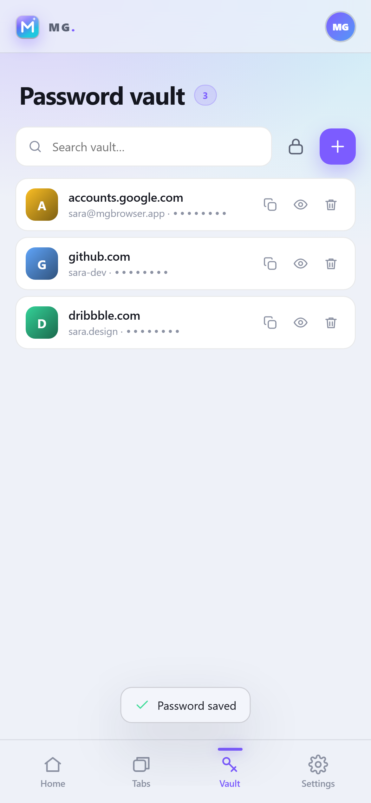
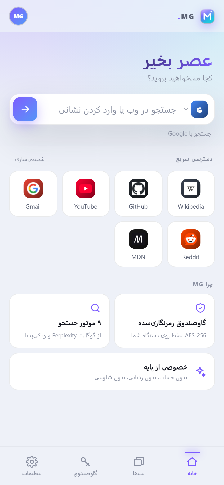

# MG Browser — Mobile

نسخه موبایل MG Browser به‌صورت **PWA** و پوسته **Capacitor** برای Android و iOS.

<p align="center">
  
  
  
</p>

## چه چیزی هست؟

MG Mobile یک مرورگر/صفحه شروع مدرن است که روی گوشی نصب می‌شود و شامل:

- **جستجو در ۹ موتور:** Google، Bing، DuckDuckGo، Brave، Yahoo، Yandex، Startpage، Wikipedia، Perplexity.
- **نتایج زنده:** پاسخ فوری ویکی‌پدیا و DuckDuckGo همراه با تصویر، در حین تایپ.
- **تب‌ها:** فهرست تب‌های باز با فاوآیکون، عنوان و زمان؛ ذخیره‌شده روی دستگاه.
- **گاوصندوق رمز:** AES-256-GCM با کلید مشتق‌شده از رمز اصلی (PBKDF2، ۱۸۰هزار دور)، تولید رمز، جستجو، کپی و نمایش.
- **ظاهر:** تم تیره/روشن/سیستم، ۸ رنگ تأکیدی، طراحی شیشه‌ای و PWA قابل نصب.
- **زبان:** انگلیسی (پیش‌فرض) و فارسی با چیدمان کامل RTL.
- **حریم خصوصی:** بدون حساب، بدون تلمتری؛ داده‌ها فقط در `localStorage` دستگاه.

## محدودیت مهم

موتور WebView در Android/iOS اجازه نمی‌دهد چند تب هم‌زمان با رابط اختصاصی و بدون پلاگین بومی رندر شوند. بنابراین در این نسخه، هنگام باز کردن یک صفحه، MG آن را به **مرورگر امن دستگاه** (Safari / Chrome Custom Tabs) می‌سپارد و تب، عنوان و تاریخچه را خودش نگه می‌دارد. برای مرور کامل با موتور داخلی و نمای تقسیم‌شده، از نسخه دسکتاپ استفاده کنید.

این تصمیم آگاهانه است: جایگزین‌های iframe به‌دلیل `X-Frame-Options` کار نمی‌کنند و یک WebView چندتبی نیازمند پلاگین نیتیو Kotlin/Swift و بیلد با Android Studio/Xcode است.

## اجرای PWA

```bash
cd mobile
npm install            # فقط برای Capacitor؛ برای PWA لازم نیست
npx http-server www -p 4173 -c-1
# یا
python -m http.server 4173 --directory www
```

سپس `http://localhost:4173` را باز کنید. روی گوشی، از منوی مرورگر **Add to Home Screen** را بزنید.

> گاوصندوق به `crypto.subtle` نیاز دارد؛ بنابراین باید از `https://` یا `localhost` اجرا شود (نه `file://`). در نسخه Capacitor، scheme به‌صورت `https` تنظیم شده است.

## ساخت اپ Android / iOS

پیش‌نیاز: Android Studio (SDK 34+) یا Xcode 15+.

```bash
cd mobile
npm install
npx cap add android          # یا npx cap add ios
npx cap sync
npx cap open android         # Android Studio
npx cap open ios             # Xcode
```

- `capacitor.config.json` از قبل تنظیم شده (`appId: app.mgbrowser`, `webDir: www`, scheme: https).
- آیکون‌ها در `www/icons/` هستند؛ برای آیکون بومی از Android Studio Image Asset یا Xcode AppIcon استفاده کنید.
- برای باز شدن صفحات در مرورگر سیستم، پلاگین `@capacitor/browser` استفاده می‌شود و در صورت نبود آن `window.open` فعال است.

## امنیت گاوصندوق

- رمز اصلی هرگز ذخیره نمی‌شود؛ فقط یک verifier رمزنگاری‌شده برای تشخیص رمز اشتباه نگه داشته می‌شود.
- کلید با PBKDF2-SHA256 (۱۸۰٬۰۰۰ دور، salt تصادفی ۱۶ بایتی) ساخته می‌شود.
- هر ورودی جداگانه با AES-256-GCM و IV تصادفی رمز می‌شود.
- در صورت فراموشی رمز اصلی، بازیابی ممکن نیست (by design).

## ساختار

```
mobile/
├─ www/
│  ├─ index.html        # رابط چهار تب: Home / Tabs / Vault / Settings
│  ├─ styles.css        # طراحی ریسپانسیو + RTL
│  ├─ app.js            # جستجو، تب‌ها، گاوصندوق، تنظیمات، i18n
│  ├─ sw.js             # کش آفلاین PWA
│  ├─ manifest.webmanifest
│  └─ icons/
├─ capacitor.config.json
└─ package.json
```

## مجوز

MIT © 2026 MG Browser
